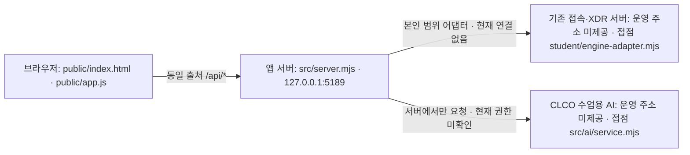

# 케셰브 학생 설명서 · 검증 중인 버전

이 문서는 학생이 작성한 21단계 설명서다. 현재 13~20단계의 학생 표시 함수와 38개 합성 회귀시험을 갖췄다. 실제 회사 시스템·AI·보안 조치·OSV 운영 연결의 완료를 뜻하지 않는다. 시작 틀 버전은 0.2.11이고 학생 구현은 v0.9 검증 중이다. 제공 README와 설명서는 보존했다.

## 새 PowerShell에서 설치·확인

Git과 Node.js가 설치된 PC에서 아직 존재하지 않는 빈 작업 경로를 선택한다. 기존 프로젝트 폴더에 다시 내려받거나 덮어쓰지 않는다. 이 앱에는 외부 npm 의존성이 없어 npm install이 필요하지 않다.

```powershell
git clone https://github.com/myeongjundev/choi-bujang-secret-vault.git keshev-clean
Set-Location -LiteralPath .\keshev-clean
node --version
npm --prefix on-client run check
node --test "on-client/student/tests/*.test.mjs"
```

실측 Node는 v24.15.0이며 제공 시작 틀 권장은 24.19.0이다. npm check는 문법 검사만 한다. 뒤 명령은 현재 소스 하나로 13~20단계 학생 함수의 정상·실패·보안 경로 38개를 검사하며, 실제 원천 연결 검사는 아니다. `.env`나 인증서·비밀값을 원본 폴더에서 복사하지 않는다.

## 실행·종료·다시 실행

위 저장소 최상위에서 다음 명령을 실행한 뒤 브라우저로 http://127.0.0.1:5189/ 를 연다.

```powershell
node on-client/src/server.mjs
```

기본값은 연결 없음이다. 사용자·기기·세션·업무 앱·기록을 불러오지 못했다는 표시가 나타나면 실제 접속이 허용됐다는 뜻이 아니다. 실행 터미널에서 Ctrl+C로 종료한다. 같은 명령으로 다시 켜고 브라우저의 다시 불러오기를 누른다.

예제 자료를 별도로 볼 때는 앞 서버를 끈 뒤 실행한다.

```powershell
node on-client/src/server.mjs --demo
```

보호 현황 → 업무 앱 → 보안 기록을 누른다. 예제 자료 표시, 연습 사용자·기기·세션, 업무 앱의 허용/거부/추가 확인, 기록 상세의 근거·규칙·상태를 확인한다. 예제는 실제 시스템 연결 재현으로 기록하지 않는다. 다시 불러오기 후 이전 판정·설명·조치 결과가 초기화되어야 한다. 실제 집행을 시험 삼아 요청하지 않는다.

5189 포트가 이미 사용 중이면 이 앱을 켠 기존 터미널에서 Ctrl+C로 종료한 뒤 다시 시도한다. 다른 사용자의 프로세스를 임의로 종료하지 않는다. 명령을 실행한 창을 닫으면 서버도 종료될 수 있다.

## 구성도와 실제 접점



네 상자에 적힌 로컬 파일은 저장소에 있다. 브라우저→앱 서버의 로컬 응답은 확인했다. 기존 접속·XDR 서버와 CLCO의 운영 주소·권한·실제 응답은 확인하지 않았다. 예제 엔진은 `src/engine.mjs`의 demoEngine이며 운영 엔진이 아니다. OSV는 `src/vulnerabilities/project-scan.mjs`와 `osv.mjs`를 거치고 담당자가 승인한 공개 패키지만 조회한다.

## 제공 코드와 학생 구현의 경계

기준 목록은 `.on-starter-manifest.json`의 sourceHashes와 제공 `docs/CURRICULUM.json`이다. sourceHashes는 시작 틀 설치 시점의 파일 목록·해시이며 학생 구현 이후 모든 파일이 원본과 같다는 보증은 아니다.

| 영역 | 담당과 현재 변경 |
| --- | --- |
| `src/`, `public/`, `vendor/`, `tools/`, 시작 틀 README·공식 안내·인증 설정 | 제공 영역. 이번 작업에서 수정하지 않음 |
| `student/engine-adapter.mjs` | 제공 연결 자리. 기본 disconnected. 실제 엔진을 구현했다고 주장하지 않음 |
| `student/extension.mjs` | 학생이 구현한 화면 함수 8개. 제공 UI가 검증한 입력을 읽어 DOM 또는 텍스트를 반환 |
| `student/tests/` | 학생이 작성한 합성 DOM·회귀시험. 운영 인증이 아님 |
| `docs/STUDENT_GUIDE.md`, 학생 검증 기록과 `student/RELEASE.md` | 학생 설명·근거·버전 문서. 공식 안내를 대체하지 않음 |

| 함수 | 학생이 구현한 내용 |
| --- | --- |
| renderIdentity | 현재 사용자·기기·세션의 이름/ID와 원래 상태 코드, 자원별 로딩·실패 표시 |
| renderDecision | 허용·거부·추가 확인·unknown, 이유·시각·앱 ID. 요청 오류를 거부 판정과 구분 |
| renderEvents | 본인 범위 최근 기록 정렬·필터·상세, 근거·규칙·접속·세션·기기 상태 |
| renderStatus | 기기·세션·알림, 공개 도움정보 여섯 필드와 사용자 클릭 시 복사 |
| renderAiConnection | idle/loading/ok/error, test/verified·모델 수·시각. 모델 목록과 사건 설명을 구분 |
| renderExplanation | 사건 요약을 현재 근거·규칙·unknown에 연결. 근거 불일치·실행 주장 거부 |
| renderAction | 준비·미실행·전송·ACK·실제 관측 효과·결과 불명을 구분. 학생 영역에 집행 요청 없음 |
| renderVulnerabilities | 정확한 설치 버전·lock 해시·OSV 출처·취약점 ID와 시각. 미조회·부분 실패·항목 없음을 구분 |

제공 UI가 네트워크 요청·취소·세대 검사·계정 승인·조치 티켓을 담당한다. 학생 함수는 매번 새 DOM을 만들고 textContent로 표시한다. 입력에 없는 권한·ID·결과를 만들지 않는다.

## 실패별 확인

| 문구 또는 코드 | 의미와 다음 확인 |
| --- | --- |
| 연결 없음 / ENGINE_NOT_CONNECTED | 원천 엔진이 연결되지 않음. 기본 실행인지 담당자 제공 연결이 있는지 확인 |
| NATIVE_HOST_DISABLED | 본인 프로젝트용 native 호스트가 활성화되지 않음. 담당자 설정 안내 확인 |
| ON_AI_PROVISIONING_PENDING / 권한 준비 중 | 앱 계정·AI 권한을 확인할 수 없음. 담당자에게 현재 계정·앱 권한 확인 요청. 열쇠를 옮겨 적지 않음 |
| WB_CLCO_AUTH_REQUIRED / ACCESS_BLOCKED | 인증·접근 권한 확인. 제공 계정 연결 화면과 담당자 안내 사용 |
| 사용량·한도·이용 시간 | 반 사용량/한도/이용 시간 구분. 자동 반복 요청 대신 담당자 확인 |
| 요청 시간 초과 / 취소 | 이전 성공을 현재 결과로 쓰지 않음. 상태를 확인한 뒤 제공 버튼으로 수동 재시도 |
| ON_AI_INVALID_INPUT / INVALID_OUTPUT | 근거 부족·다른 사건 인용·잘못된 출력 등. 기존 기록을 확인하고 설명을 사실로 사용하지 않음 |
| 결과 불명(unknown) | 조치의 성공이나 효과 없음으로 단정하지 않음. 새 집행 대신 결과만 재조회 |
| not_configured | 조회 프로젝트 미설정. 운영자가 준비한 대상 경로 확인 |
| not_checked | 승인된 공개 조회 대상이 없어 미조회. 승인 목록을 임의 확대하지 않음 |
| partial / unverifiable | 일부 조회 실패 또는 lock/응답 확인 불가. 이미 받은 ID는 보존하고 전체 안전으로 해석하지 않음 |
| none_found | 그 조회 시점·범위에 알려진 항목 없음. 시스템 전체의 안전 보증이 아님 |

도움정보 복사는 requestId·component·version·checkedAt·engine.mode·engine.code만 사용한다. 비밀번호·토큰·키·인증서·원문 오류·전체 환경을 문서·채팅·화면·커밋에 넣지 않는다.

## 확인 범위와 기다림(UNV)

현재 소스의 38개 합성 시험, 문법 검사, 로컬 기본/예제 실행과 새 복제에서의 확인 결과는 `STUDENT_CLEAN_REPRODUCTION.md`에 기록한다. 공식 통과는 상황실에서 받은 코드 원문 판정이며 서버가 이 앱을 실행한 증거가 아니다.

다음 항목은 기다림(UNV) 또는 미확인이다: 실제 사용자·기기·세션의 운영 엔진 연결, 앱 계정/AI 권한과 실제 사건 설명 호출, 실제 SDP 조치 준비·사람 확인·집행·효과 재조회, 실제 설치 프로젝트와 승인 패키지에 대한 OSV 조회. 현재 반은 20단계까지만 공개되어 21·22 공식 접수도 대기 중이다.

운영 키·권한을 임의 발급하거나 대체 연결을 만들어 이 항목을 채우지 않는다. 전체 완료·v1.0은 동일 최종 소스의 누적 재현과 실제 집행 연결, 공식 최종 수용 조건을 충족한 뒤에만 표시한다.
